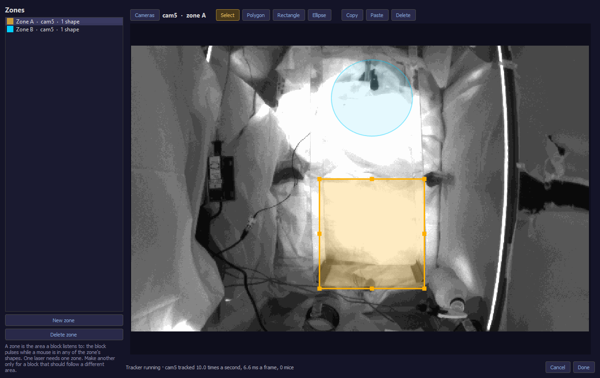

# Closed-loop stimulation

Previous: [CPU_ENCODE.md](CPU_ENCODE.md). Next: [INTERNALS.md](INTERNALS.md), for maintainers.

A closed loop makes a stimulation block pulse only while an animal is in a zone you draw on a camera. That's how you run real-time place preference with optogenetics. Panopticon tracks the animals live with a SLEAP model, decides several times a second whether each zone holds one, and tells the trigger board. The board then runs or holds each zone block's pulses.

This page is for setting it up on your rig, and above all for bringing your own SLEAP model. [Closed-loop stimulation](WORKFLOW.md#closed-loop-stimulation) in the workflow walks through a session once it's set up.

---

## What's new

If you've used Panopticon's stimulation editor before, this is what closed loop adds:

- **In zone** in the stimulation editor. Tick it and press **Create Block**, and the zone editor opens for you to draw or pick the block's zone. The block's header then reads `zone A`, and a double click on it opens its zone.
- **The zone editor** shows every camera live. Click one to draw on it with **Polygon**, **Rectangle** and **Ellipse**. **Select** moves and resizes shapes, and **Copy**, **Paste** and **Delete** work on them. A zone is a set of shapes on one camera, named by a letter from A to P. **New zone** adds another, and two zones can share a camera. The mice the tracker finds are marked with lime circles.
- **Zones**, in the stimulation editor, opens the zone editor without creating a block. **Save** and **Load** keep the zones with the blocks.
- **Apply** builds a sketch that holds each zone block's pin low until the window reports an animal in its zone. A paradigm without zone blocks compiles exactly as before, so no board is reflashed for it.
- **The live preview** outlines the applied zones on their cameras, each in its own colour, and fills a zone while an animal is in it.
- **The Expected stimulation panel** says, for each zone block, whether an animal is in its zone, and lights the block only then. Each block in the panel shows its pin and parameters.
- **Record** refuses to start a paradigm with zone blocks until every zone has shapes on an open camera and the tracker is running. [The refusals](WORKFLOW.md#closed-loop-stimulation) are listed in the workflow.
- **New files** in each closed-loop recording: `closed_loop.csv` (the animals found in every tracked frame) and `closed_loop.json` (the settings, the zones and each zone's changes). `stim_trace.csv` gains a `zone_<letter>_in` column per zone.
- **A new profile block**, [`closed_loop`](CONFIGURATION.md#closed-loop-the-closed_loop-block), names the tracker and its model.

---

## What you need

- **An NVIDIA GPU.** The model runs on it with ONNX Runtime. On our rig, an RTX 5080 that also encodes nine cameras, it takes about 6.5 ms a frame.
- **Panopticon's trigger board** (`trigger_source: board`). The zones reach the stimulation through the board's sketch, so a profile on an external trigger source can't use them.
- **A tracker.** Either a SLEAP centroid model for your cameras ([Bring your own SLEAP model](#2-bring-your-own-sleap-model)), or the threshold tracker, which needs no model and finds dark animals on a bright floor ([`tracker`](CONFIGURATION.md#closed_looptracker)).
- **A light on the stimulation pin that the cameras can see**, such as an LED, for checking the loop before an animal is stimulated ([Check the loop with a light](#4-check-the-loop-with-a-light)).

---

## 1. Set up the tracker's Python

The tracker runs in a Python environment of its own, so its GPU libraries stay out of Panopticon's. You'll do this once per computer. In PowerShell:

```powershell
uv venv C:\tracker-env --python 3.12
uv pip install --python C:\tracker-env\Scripts\python.exe "onnxruntime-gpu[cuda,cudnn]" numpy opencv-python-headless
```

The `[cuda,cudnn]` extra brings the CUDA libraries with it, so you don't install CUDA yourself. The folder can be anywhere: the profile names it in [step 3](#3-point-the-profile-at-it).

---

## 2. Bring your own SLEAP model

Panopticon runs any SLEAP centroid model that meets the requirements below, exported to ONNX. Our rig uses one trained on all nine of its cameras, and you'll want one trained on yours.

### What the model must be

- **A centroid model** from [sleap-nn](https://nn.sleap.ai/). Panopticon reads only where each animal is, not its pose. The centroid half of a top-down model works on its own. A bottom-up or single-instance model doesn't, so train a centroid model next to it.
- **Trained on frames like the live ones**: your cameras' raw frames, as one gray channel. Set `ensure_grayscale: true` in the training config, so the model takes `in_channels` 1. Panopticon has only the frame it's tracking, so a model whose input stacks a background, a later frame or a motion channel can't run live.
- **Trained at your cameras' full frame size.** Panopticon feeds each whole frame, padded at the bottom and right to a multiple of 32 pixels: a 1920x1200 camera feeds 1920x1216. Our export takes any size, but if your sleap-nn version fixes the size at export, it must be that padded size.
- **Anchored on the body.** The centroid is the point the zones test, so choose an anchor that stays on the animal's body. We added a `body_center` node, the mean of the keypoints off the tail. A centroid at the middle of the animal's bounding box swings with the tail and can sit outside the animal.
- **Trained on every camera you'll draw zones on.** One model can serve them all. A model trained on the camera above the arena may miss animals in the side views.
- **Able to find every animal**: export it with a maximum number of instances at least the number of animals in the arena.

### Train it

1. **Pick frames** from your recordings, from every camera you'll track, across sessions and animals. Include every coat colour you'll run. On our rig, the model misses white CD1 mice far more often than dark ones, and on three of our cameras it barely sees them.
2. **Label them in SLEAP**, with your anchor node on each animal.
3. **Train a centroid model with sleap-nn**, with the gray, full-size input above. [sleap-nn's documentation](https://nn.sleap.ai/) covers the training config. What we used, for reference: `ensure_grayscale: true`, `max_height: 1200`, `max_width: 1920`, `scale: 0.5`, rotation augmentation over the full circle, and contrast and brightness augmentation. The half scale keeps the model at about 6.5 ms a frame on our GPU.
4. **Score it** on sessions it didn't train on, camera by camera and coat colour by coat colour. Count how often it misses an animal that's there, and how often it marks one that isn't. Those two numbers decide [`min_confidence`](CONFIGURATION.md#closed_loopmin_confidence) and the zone's hysteresis.

### Export it to ONNX

Export the centroid model's folder on its own, not as a centroid and centered-instance pair:

```
sleap-nn export models/my_centroid -o exports/my_centroid --format onnx --max-instances 6
```

That writes `model.onnx` and `export_metadata.json` into `exports/my_centroid`. Keep the two together. The flags are from sleap-nn's current documentation, and our model was exported with sleap-nn 0.1.0. Run `sleap-nn export --help` to check them for your version.

Use ONNX, not a TensorRT engine. An engine runs only on the GPU type and the TensorRT version that built it, while ONNX Runtime runs the `.onnx` file on any NVIDIA GPU.

### Check the file

Before you point Panopticon at the model, check it with the tracker's Python:

```powershell
C:\tracker-env\Scripts\python.exe -c "import onnxruntime as ort; s = ort.InferenceSession(r'C:\models\my_centroid\model.onnx'); print([(i.name, i.shape, i.type) for i in s.get_inputs()]); print([o.name for o in s.get_outputs()])"
```

You want:

- one input, of shape `[batch, 1, height, width]`, where the 1 is the gray channel. Ours prints the words `batch`, `height` and `width`, because it takes any size. If yours prints numbers for the height and width, they must be your frame's, padded to a multiple of 32;
- an input type of `tensor(uint8)`: Panopticon feeds the camera's 8-bit pixels as they are, and the export scales them itself;
- outputs that include `centroids` and `centroid_vals`.

Ours prints `[('image', ['batch', 1, 'height', 'width'], 'tensor(uint8)')]` and `['centroids', 'centroid_vals', 'instance_valid']`. Panopticon refuses a model with another number of channels, or without `centroids` and `centroid_vals`. A model that wants another input size or type fails as the tracker starts, since the tracker runs one frame through it first. Either way, the zone editor's status line shows why.

### Point the profile at it

Copy the export folder to the rig computer, and name the model and the tracker's Python in your profile's [`closed_loop`](CONFIGURATION.md#closed-loop-the-closed_loop-block) block, as in [step 3](#3-point-the-profile-at-it).

### Check it on your rig

1. Open the stimulation editor's **Zones**, and click a camera. The status line reads, for example, `Tracker running · cam5 tracked 10.0 times a second, 6.5 ms a frame, 2 mice`.

    
2. With animals in the arena, watch each camera you'll draw zones on for a minute. Every animal should carry a lime circle, and nothing else should. If something that isn't an animal is marked, raise [`min_confidence`](CONFIGURATION.md#closed_loopmin_confidence). If animals go unmarked, lower it, or train the model on more frames from that camera.
3. Keep hands out of a zone while an animal is stimulated: a model can take a hand for an animal. Ours does.
4. Record a session with zones, and score it afterwards. `closed_loop.csv` keeps every detection with its confidence, as `x:y:confidence`, so you can check another threshold without recording again.

---

## 3. Point the profile at it

Add a `closed_loop` block to your profile, with the model and the tracker's Python:

```yaml
closed_loop:
  model: C:/models/my_centroid/model.onnx
  python: C:/tracker-env/Scripts/python.exe
  min_confidence: 0.3
```

A relative `model` path starts at the Panopticon folder. Relaunch Panopticon for the change to take. The tracker starts when you open the zone editor or apply a paradigm with zone blocks, and the log's `tracker ready` line names the providers it runs on. `CUDAExecutionProvider` first means the GPU.

These settings are worth a look once the model works:

| Setting | Default | Change it when |
|---|---|---|
| [`min_confidence`](CONFIGURATION.md#closed_loopmin_confidence) | 0.2 | The tracker marks things that aren't animals (raise it), or misses animals (lower it). Ours is 0.3 |
| [`enter_updates`](CONFIGURATION.md#closed_loopenter_updates) | 2 | A zone turns on for a stray detection. More updates wait longer before turning a zone on |
| [`leave_updates`](CONFIGURATION.md#closed_loopleave_updates) | 3 | A zone flickers off while an animal sits in it, because the model misses it for a frame now and then. Ours is 5 |
| [`rate_hz`](CONFIGURATION.md#closed_looprate_hz) | 10 | You want a faster response, and the GPU has time to spare |
| [`lost_s`](CONFIGURATION.md#closed_looplost_s) | 0.5 | A camera stops being tracked, and you want its zones off sooner or later |

One tracker serves every camera a zone is drawn on, in turn, so its GPU time adds up. A frame's time, times `rate_hz`, times the cameras with zones, has to stay well under a second. On our rig, five cameras at 10 Hz and about 6.5 ms a frame take a third of a second each second.

---

## 4. Check the loop with a light

Before you stimulate an animal, check the whole loop with a light the cameras can see.

1. Wire an LED to the stimulation pin where the cameras can see it. Whatever else is on that pin while you test is your lab's to make safe, as for any paradigm ([the stimulation warning](INSTALLATION.md#step-8--flash-the-trigger-firmware)).
2. Draw a zone, make a block on that pin that follows it, and press **Apply**. A pulse width at or above the period (100 ms at 20 Hz) holds the LED on while the zone is on, which is the easiest to see.
3. Record while an animal, or anything your model marks, moves in and out of the zone.
4. Watch the recording. The LED should light only while `zone_<letter>_in` in `stim_trace.csv` reads 1. On our rig it switched 10 to 30 ms after each zone change the window sent.

List the stimulation pin in [`stim_safe_pins`](CONFIGURATION.md#stim_safe_pins), so the sketch drives it low as soon as it starts, before it waits for the host.

---

## 5. How it behaves

- **Any animal counts.** With cagemates in the arena, a cagemate in the zone turns it on.
- **Timing.** With the defaults, a zone turns on 0.1 to 0.2 s after an animal enters, and off 0.2 to 0.3 s after it leaves. A pulse already running when a zone turns off still finishes, and an animal that comes straight back never makes the pulses come faster than the block's frequency.
- **A dropped link turns zones off.** The window resends each zone's state 20 times a second. If the updates stop, because the tracker or Panopticon stopped, the board turns the zone off 250 ms later. Stopping the recording turns every zone off too.
- **A block's duration is clock time.** It counts from the block's start, whether or not an animal is in the zone, so a 600 s zone block ends 10 minutes later however long it stimulated. When it ends, the chain moves to its next block, or holds the pin low for the rest of the recording. The tracking goes on, and `closed_loop.csv` keeps logging, until you stop. To stimulate for a whole session, give the zone block a duration at least as long as the recording, or tick **End** on it so the recording stops with it.
- **Several lasers.** Give each laser its own block and zone. A block follows one zone, a zone can serve several blocks, and two zones can share a camera.
- **Zones aren't restored at launch.** The arena can sit a little differently from one session to the next, so **Load** the paradigm's file and check its zones against the live view.

[What a closed-loop recording writes](WORKFLOW.md#closed-loop-stimulation), and what each refusal means, are in the workflow.
