# Running a session

A session is one visit to the rig: we launch Panopticon, tell it which rig and which animals, calibrate the cameras, and record. Let's walk through a whole session, in the order you'll do it.

If you haven't set up the rig yet, start with [INSTALLATION.md](INSTALLATION.md). [OVERVIEW.md](OVERVIEW.md) names every part of the window, and if a message pops up that you don't recognise, look it up in [TROUBLESHOOTING.md](TROUBLESHOOTING.md).

> [!NOTE]
> The screenshots come from our rig, nine Basler cameras described by `profiles/3dpose.yaml`, and so does every number marked "on our rig". Your window will show your own cameras, but everything else works the same way. The pictures of the stimulation bolt and the **Expected stimulation** panel, and the clips of the editor and of a short take, come from the [simulated rig](SIMULATION.md), which shows the same sidebar and editor.

You'll keep coming back to two places in the window. The **state label** is the coloured word at the bottom right of the sidebar, and it reads **IDLE** whenever Panopticon is waiting for you. The **status bar** is the line of text along the bottom of the window.

1. [Launch](#1-launch)
2. [Choose a profile](#2-choose-a-profile)
3. [Set the output directory](#3-set-the-output-directory)
4. [Fill in the metadata](#4-fill-in-the-metadata)
5. [Calibrate](#5-calibrate)
6. [Solve](#6-solve)
7. [Optional: stimulation](#7-optional-stimulation)
8. [Record](#8-record)
9. [After you stop](#9-after-you-stop)
10. [What the session leaves on disk](#10-what-the-session-leaves-on-disk)

---

## 1. Launch

Let's start Panopticon and make sure every camera comes up.

1. Double-click the **Panopticon** shortcut on your desktop. No shortcut? Double-click `_launch.bat` in the Panopticon folder instead. That's the repository folder you cloned during [installation](INSTALLATION.md#step-3--get-the-code), `C:\Users\you\Desktop\panopticon` if you followed it.

2. A splash screen shows what Panopticon is up to while it opens the cameras. On our rig, the window appears after about 17 seconds.

    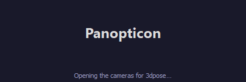

3. The window opens and every pane fills with live video. **Record** and **Calibrate** stay greyed out for now, while Panopticon checks the computer in the background:

    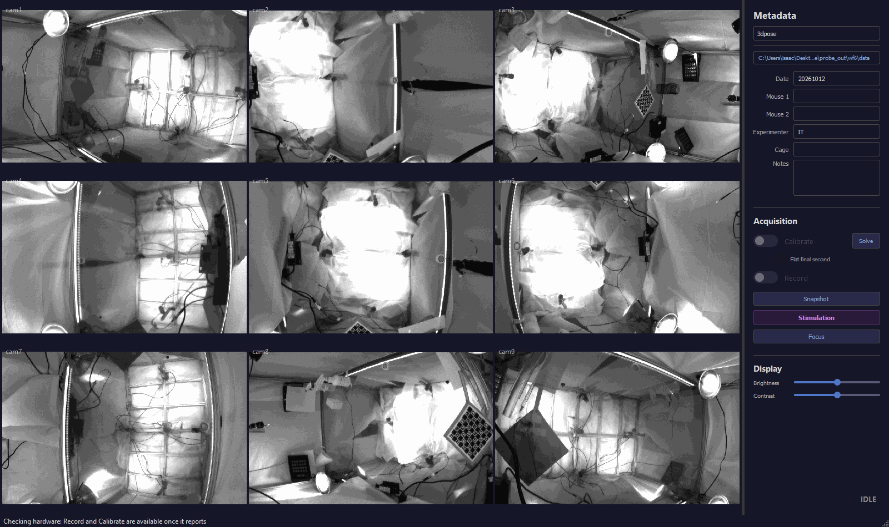

4. If a **Hardware Check** dialog pops up, read it and press **OK**. It won't stop you, but it's worth a look before you record. Here, it's saying the GPU encoder will use its slower host upload today:

    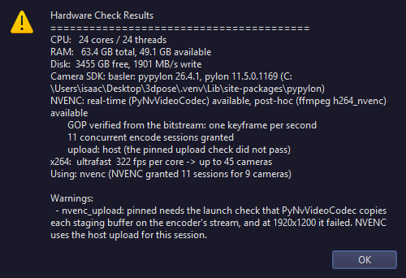

5. When the status bar reads `Hardware check done: encoding with <encoder>` and the state label reads **IDLE**, you're ready to go:

    

Take a quick look over the grid. Every camera should have a live pane, and each pane should read about 30 fps, the rate Panopticon previews at.

> [!TIP]
> You can also start Panopticon from PowerShell: run `uv run gui.py` in the Panopticon folder, and you'll see the log scroll past in the terminal. Add `--profile <name>` to open a particular profile (Panopticon remembers it for next time). The same options work with `.\_launch.bat`, but the shortcut doesn't take any.

> [!NOTE]
> The desktop shortcut doesn't install anything new. After an update that changes `pyproject.toml`, run `uv sync` once, or start with `_launch.bat`, which does it for you ([Updating Panopticon](INSTALLATION.md#updating-panopticon)).

### What happens at launch

Every time it starts, Panopticon:

1. opens your rig's cameras and starts the preview;
2. checks the computer in the background (the CPU, the RAM, the output drive and the GPU encoder) and picks the encoder it'll record with;
3. puts the trigger board back on its [recording-only sketch](GLOSSARY.md#recording-only-sketch), which triggers the cameras and drives no stimulation pin. The state label reads `Clearing stim firmware…` while it works;[^clear]
4. opens the board's serial port and holds on to it until you quit.

Stimulation stays off until you apply a paradigm in this launch ([section 7](#7-optional-stimulation)).

[^clear]: A paradigm stays on the board even through a power cycle, which is why Panopticon clears it every time. It skips the flash only when this computer knows the board already carries the recording-only sketch.

### The log

Everything Panopticon prints goes into a log file, one per launch, at `logs\panopticon_<date>_<time>.log` in the Panopticon folder. Each line starts with the time and the name of the thread that printed it:

```
2026-09-24 10:15:02.481 [MainThread] [acq] profile: 3dpose
```

Near the top, a block of `[header]` lines describes the computer, the profile and each open camera, from Panopticon's version and the GPU driver down to the network links. The header is written again whenever you switch profile or start an acquisition.

The profile's `log_level` sets how much else goes in. The default, `verbose`, adds the camera settings Panopticon asked for and what the cameras reported back, and a `[state]` line at each step of an acquisition ([CONFIGURATION.md](CONFIGURATION.md#log_level)).

Each recording and calibration also gets its own `session.log`, the slice of the log from arming the cameras to the end of the encode. When you report a problem, attach both.

### If something looks different

- **Panopticon is already running.** Only one copy can run at a time, since two would fight over the cameras, the trigger board and the GPU. Find the open window on the taskbar and use that one. If you're sure the other copy isn't holding the hardware, `--force` starts a second one anyway.
- **Hardware Check lists something you don't recognise.** The dialog lists everything the check didn't like, such as fewer than 4 CPU cores or under 16 GiB of RAM. It also wants the output drive to have 500 GiB free and to write at 500 MiB/s or more, and the GPU encoder to work properly. [The hardware check](TROUBLESHOOTING.md#the-hardware-check) says what to do about each.
- **A pane is missing or black.** Fix that before anything else. [Opening the cameras](TROUBLESHOOTING.md#opening-the-cameras) explains the messages a camera can show.
- **One pane's frame rate reads well below the others.** See [Frame rate](OVERVIEW.md#3-frame-rate).
- **Choose your rig's profile, and no cameras.** Panopticon hasn't opened a profile on this computer yet, or the one it remembers didn't load. Until you choose one, it leaves the cameras and the trigger board alone. Press **OK** and carry on with [section 2](#2-choose-a-profile).
- **No rig profile.** None of the profiles loaded, so **Record** and **Calibrate** stay off. The board hasn't been cleared either, and it may still carry a paradigm, even a looping one. Fix the profile the dialog names, then start Panopticon again.
- **Could not clear stim firmware.** The board couldn't be flashed, so it may still carry an earlier paradigm. Before you record, open **Stimulation** and press **Apply to Arduino** with an empty canvas.

[*Next up:* Choose a profile](#2-choose-a-profile)

---

## 2. Choose a profile

A **profile** is a YAML file in `profiles/` that describes a rig: its cameras, frame rates, trigger board and pins, encoder and output folder. [CONFIGURATION.md](CONFIGURATION.md) describes every setting. Panopticon remembers the profile you pick, so you'll only do this once per computer.

If the box at the top of the sidebar already shows your rig's profile (`3dpose` on our rig) and every pane is live, skip ahead to [section 3](#3-set-the-output-directory).

1. Click the box under **Metadata**, at the top of the sidebar. The list shows every profile that loaded:

    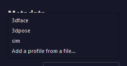

2. Click your rig's profile. The state label reads `Switching cameras…` while Panopticon closes the old cameras and opens the new ones.

3. Wait for **IDLE**. The grid now shows your rig's cameras.

> [!TIP]
> Keep your profile somewhere else? Choose **Add a profile from a file…** at the bottom of the list. Panopticon adds it to the list for every later launch and switches to it.

> [!NOTE]
> Using FLIR cameras? Start with [FLIR.md](FLIR.md), which covers their part of the profile and the Spinnaker SDK.

### Camera names

Panopticon calls the cameras `cam1`, `cam2` and so on, and uses those names in every file and in the calibration. If the profile lists `camera_serials`, `cam1` is the first serial in that list. If it doesn't, the cameras are numbered in serial-number order, so one missing camera renames every camera after it, and the calibration ends up describing the wrong cameras. It's worth setting `camera_serials`, or at least `n_cameras`, so Panopticon refuses to open an incomplete set instead ([CONFIGURATION.md](CONFIGURATION.md#camera_serials)).

### If something looks different

- **Your profile isn't in the list.** It didn't load. Look for a **Rig profiles** dialog after the window opens: it names the file and the setting at fault.
- **`Expected N cameras but M are available to open.`** or **`Requested cameras did not enumerate: ...`** A camera is missing. Power-cycle it and choose the profile again.
- **A camera won't open because of its format or size.** Every camera has to send Mono8 at the profile's `frame_width` and `frame_height` ([Opening the cameras](TROUBLESHOOTING.md#opening-the-cameras)).
- **No camera opens, and the dialog names `capture_processes`.** Capturing in several processes is still experimental, so the window won't open a profile that sets `capture_processes` above 0 ([CONFIGURATION.md](CONFIGURATION.md#capture_processes)).
- **Your profile sets `trigger_source: external`.** Your own TTL source triggers the cameras, so Panopticon opens no serial port and flashes nothing. Recording works a little differently: see [Your own trigger source](#your-own-trigger-source).

[*Next up:* Set the output directory](#3-set-the-output-directory)

---

## 3. Set the output directory

Panopticon writes every session into a folder under the **output directory**, and the button under the profile box shows which folder that is. Each profile remembers its own, so choose the profile first. Pick a folder on your biggest, fastest drive, since that's the drive the disk check measures when you press **Record**.

1. Click the folder button. A `Select Output Directory` dialog opens.
2. Pick the folder and click **Select Folder**. The button now shows the new path.

On our rig, sessions go to the `data` folder inside the Panopticon folder. Until you pick a folder, a profile uses its own `output_dir`.

Each session ends up in `<output>/<date>/<mouse1>_<mouse2>/`, with a `calibration/` folder and a `<mouse1>_<mouse2>_recording/` folder inside ([Paths and names](#paths-and-names)).

### If something looks different

- **`Disk may be short` or `Disk is tight` when you press Record.** The drive may be too full for a 10-minute recording. Free some space, or come back here and pick a folder on a bigger drive.

[*Next up:* Fill in the metadata](#4-fill-in-the-metadata)

---

## 4. Fill in the metadata

Next, let's tell Panopticon who's in the arena today. The fields name the session's folder and files, so fill them in before you calibrate.

1. Check **Date**. It holds today's date as `YYYYMMDD`, so you'll rarely need to touch it.
2. Type the animals' IDs in **Mouse 1** and **Mouse 2**. Recording a single animal? Leave **Mouse 2** blank, and the folder is named `<mouse1>_m2`.
3. Put your initials in **Experimenter**, and check **Cage** and **Notes**, which still hold whatever was typed last on this computer.

    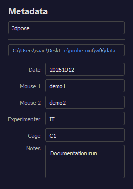

With the fields above, the session folder is `<output>/20261012/demo1_demo2/`, and cam1's recording will be `20261012-demo1_demo2-cam1-recording.mp4`.

| Field | Default | Goes into |
|---|---|---|
| Date | today, as `YYYYMMDD` | folder and file names |
| Mouse 1, Mouse 2 | blank, which becomes `m1` and `m2` | folder and file names |
| Experimenter, Cage, Notes | what you typed last, or the profile's `metadata_defaults` | `session_metadata.json` |

Whatever the fields hold when an acquisition ends is saved in `session_metadata.json`, so fix anything left over from the last person. Everything except the date comes back at the next launch. On our rig, the profile also fills in Experimenter `IT` and adds the assay (`open_field`) to `session_metadata.json`, since there's no field for it ([CONFIGURATION.md](CONFIGURATION.md#metadata_defaults)).

> [!TIP]
> Don't change the Mouse fields between **Calibrate** and **Solve**. Solve looks for the calibration in whichever folder the fields name when you press it.

> [!NOTE]
> As long as you haven't typed into **Date**, it rolls over to the new day by itself when you press **Calibrate** or **Record**, so a session started after midnight is filed under the day it started.

### If something looks different

- **Check the session details.** One of the fields can't be used: the date isn't a real `YYYYMMDD` date, or a value can't be part of a folder name (a slash, `..`, a reserved Windows name, or a trailing dot or space). Fix the field and try again.

[*Next up:* Calibrate](#5-calibrate)

---

## 5. Calibrate

Before we can reconstruct anything in 3D, Panopticon needs to know where each camera is and how its lens bends the image. We get that by recording a **calibration**: a short take of the ChArUco board being carried through the arena. The **Solve** step (next section) turns it into a model of every camera.

Make sure the arena is empty and you have the board handy.

### Check the focus

A soft lens hides in the preview and shows up later as a camera the solve leaves out.
Before the first calibration on a rig, or after anyone has touched a lens, lay the
board in the middle of the arena and open **Focus**. Every camera that sees the board
should decode most of its markers. If one reads far fewer than its neighbours, focus it
as [The Focus window](OVERVIEW.md#the-focus-window) describes.

Here it is on our rig. Click a tile to see that camera's whole view, with a box around
the markers it decodes. The board lay where cam8 sees all of it, while cam5 and cam2
catch only its edge, so their low counts say nothing about their focus:

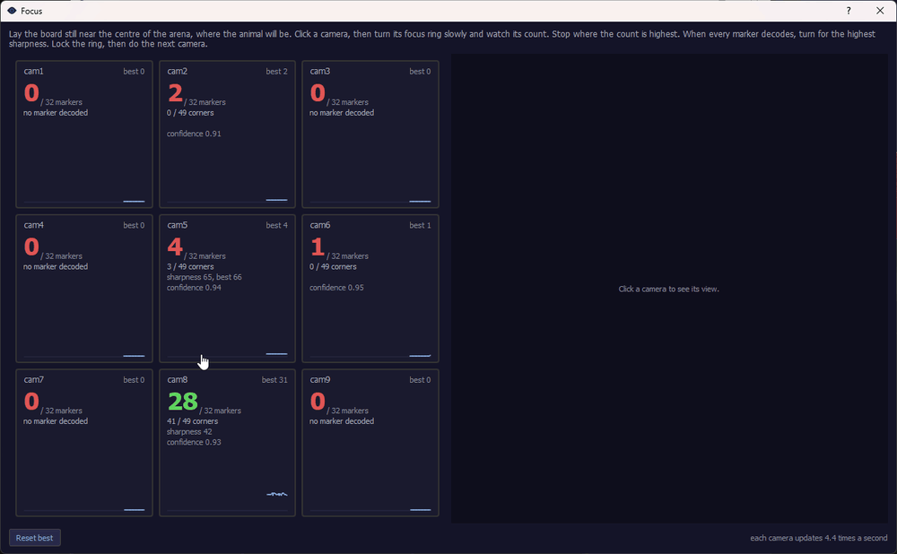

### Start the calibration

1. *(Optional)* If you want LUC3D's floor grid to sit on the arena floor, tick **Flat final second** under **Calibrate**. You'll end the take by laying the board down (more on that below).

    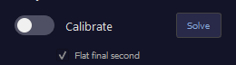

2. Flip **Calibrate** on. After a few seconds, the state label switches to **CALIBRATING** and the coverage display appears in the sidebar:

    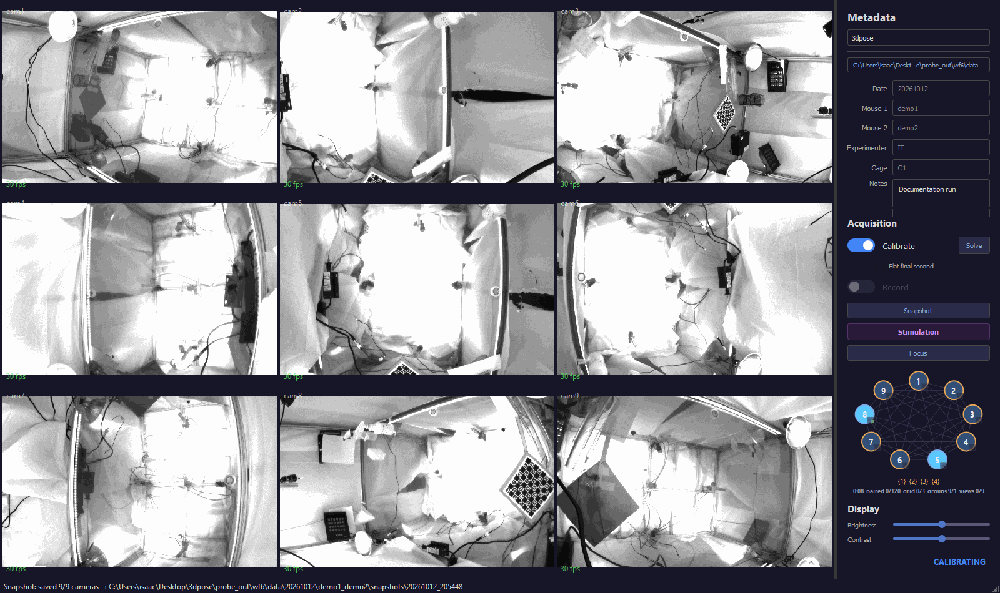

> [!TIP]
> Drag the divider on the left edge of the sidebar to make the coverage display bigger. It's a lot easier to read that way.

### Wave the board

Now pick up the board and walk it slowly through the arena. Pause for a moment at each pose. The calibration exposure is long, so a moving board comes out blurry and gets ignored.

As you go, the coverage display fills in:

- A camera's node **lights up** when it can see the board.
- The line between two cameras **thickens** as they see the board together.
- The little grid on each node shows which **quarters** of that camera's view the board has visited.

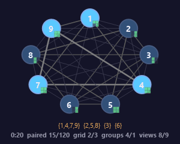

Try to get the board into every corner of every camera's view, tilted as well as face-on, and spend some time where neighbouring cameras can see it at once. If an orange line shows up under the graph, it's telling you what's missing. For example, `weakest link {1,4,7,9} to {2,3,5,6,8}` means you should hold the board where a camera from each group can see it.

When the whole graph turns white and reads **READY**, you have enough. This usually takes a few minutes.

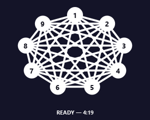

> [!NOTE]
> It's fine to keep going after READY. Every extra view goes into the solve.

### Finish

1. If you ticked **Flat final second**, lay the board flat on the floor where the cameras can see it, and leave it there for a second or two.
2. Flip **Calibrate** off. Panopticon writes out the videos (the toggle stays greyed out while it works), then goes back to **IDLE**:

    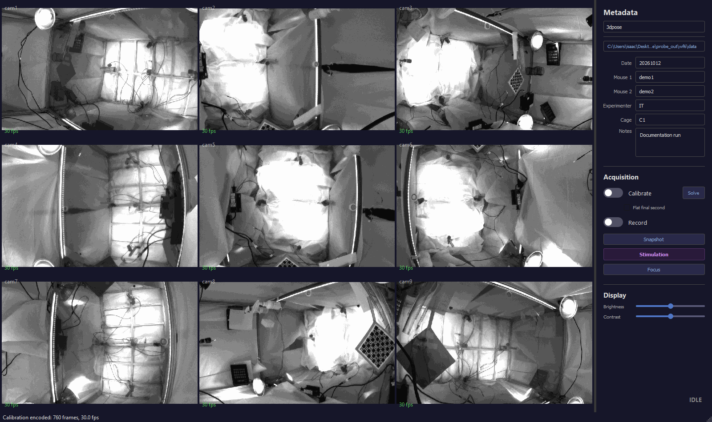

That's it! The calibration is saved in the session's `calibration/` folder.

> [!TIP]
> Calibrating again in the same session? Panopticon will ask **Overwrite the existing data?** Choose **Yes** to replace the old take.

### If something looks different

- **The panes look brighter than usual.** Nothing's wrong. A calibration uses its own exposure and gain from the profile (`calibration_exposure_us`, `calibration_gain_db`) and runs at `calibration_frame_rate`, 30 fps on our rig. The next recording goes back to the usual settings.
- **A node never lights up.** Its camera can't see the board. Check the camera's view and its focus.
- **The board is too dark to detect.** Add infrared light first, then raise `calibration_exposure_us` in the profile. The brightness and contrast sliders won't help.
- **The display stops filling in.** The caption under the graph names what's short, and [The calibration coverage HUD](OVERVIEW.md#the-calibration-coverage-hud) explains each figure. For two cameras that face each other, try holding the board edge-on between them.
- **The display stays dark, or READY comes but the solve finds few corners.** The printed board may not match the board file your profile names in `board_config` ([CONFIGURATION.md](CONFIGURATION.md#board_config)). Ours, `configs/boards/charuco_8x8_15mm.yaml`, is 8 × 8 squares of 15 mm with 10 mm markers. Count the squares and measure one, and if they differ, ask the rig's owner. Be careful with this one, because a wrong square size doesn't show up anywhere: the solve looks fine, and every 3D coordinate comes out at the wrong scale.
- **The state label reads `Flashing recording-only firmware…` first.** You applied a paradigm earlier. A calibration always runs without stimulation, so Panopticon swaps the paradigm off the board and starts once the flash ends.
- **No coverage display appears.** The calibration still records. [Coverage display](OVERVIEW.md#12-coverage-display) lists what hides it.
- **A dialog refuses the start.** A calibration runs the same checks as a recording ([Starting an acquisition](TROUBLESHOOTING.md#starting-an-acquisition)).
- **A camera gets bumped after you calibrate.** Calibrate again before you record. The calibration describes the cameras as they were, and nothing warns you when one moves: its 3D just comes out wrong.

[*Next up:* Solve](#6-solve)

---

## 6. Solve

Now let's turn the calibration into a model of the cameras. The [solve](GLOSSARY.md#solve) works out each camera's lens and where it sits relative to the others.

1. Wait for **IDLE**, and check that Date, Mouse 1 and Mouse 2 still name the session you just calibrated.

2. Press **Solve**. The state label turns purple and reads **CALIBRATING...**, and the status bar shows how the solve is getting on:

    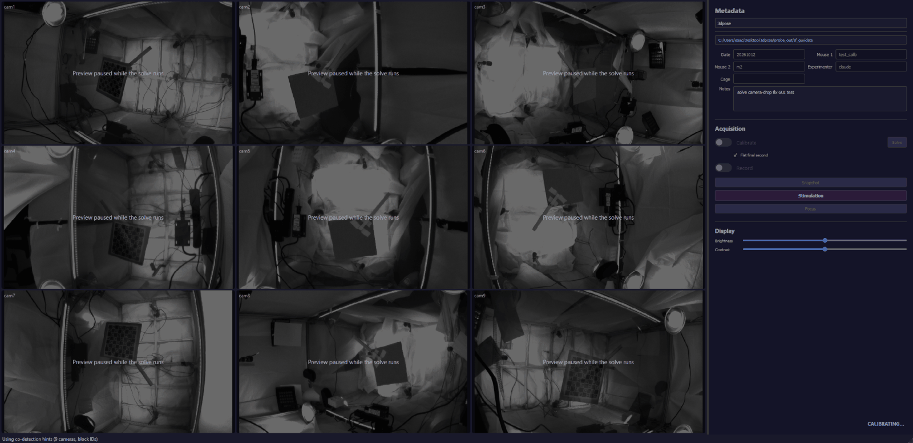

3. Wait while it works. The preview pauses for the whole solve: every pane keeps its last picture and reads **Preview paused while the solve runs**, and **Calibrate**, **Record**, **Snapshot** and **Focus** stay greyed out until it's done. On our rig, solving nine cameras takes about a minute and a half.

4. When it's done, the preview comes back, the state label goes back to **IDLE** and the status bar reads `Solved N of M cameras — copied to <path>`. If N and M match, every camera made it in:

    

    Here all nine made it in. The end of the line says which cameras placed the floor, and that the solve left a note in `session.log` ([Reading the status bar](#reading-the-status-bar)).

5. Open `reprojection_error_histogram.png` in the session's `calibration/` folder and check that every bar is green ([Reading the pairwise calibration plot](#reading-the-pairwise-calibration-plot)).

Nice! The solve saved `calibration.toml` in `calibration/` and copied it into the recording folder, so the recording you're about to make carries the calibration it was made with.

### Reading the status bar

| Status bar | What it means |
|---|---|
| `Solved N of M cameras — copied to <path>` | Copied into `<mouse1>_<mouse2>_recording/`. N below M means some cameras were left out |
| `Solved N of M cameras — kept in calibration/, recording's copy left unchanged` | You answered **No** to **Replace the recording's calibration?** |
| `...; unreliable: camN` | That camera's lens fit or position is off. The log says why and what to film |
| `...; floor from camN, camM` | Those cameras' views of the board lying flat put the floor at Z = 0 |
| `...; floor skipped` | The board was still moving at the end of the take, or no camera saw it lying down. The rest of the calibration is fine |
| `... (N note(s) in session.log)` | The calibration is sound. Its notes are in `calibration/session.log` |
| `... — recalibration recommended` | A **Recalibration recommended** dialog says why. Calibrate again |
| `Calibration solved (no toml found to copy)` | Treat it as a failure, and read the log |

### Which cameras made it into the solve

A camera is left out of the solve when it has no calibration video that can be read, or fewer than 5 frames with the board in them. It's also left out when its lens fit fails (the fit needs 20 or more frames with 6 or more corners each), or when it isn't linked to the biggest group of cameras that saw the board together.

The solve still succeeds without them, and a **Recalibration recommended** dialog says `PARTIAL: solved N of M cameras.` and names each missing camera with its reason. A camera that's left out adds nothing to 3D, so calibrate again, holding the board where that camera and a neighbour can both see it.

If the same camera keeps failing its lens fit, check its focus before you calibrate again (see [Check the focus](#check-the-focus)). A soft lens can still count towards **READY**, which needs 5 markers in a view. The solve needs 6 corners from a view, and the few scattered markers a soft lens decodes rarely give them.

### Reading the pairwise calibration plot

`reprojection_error_histogram.png` has one bar per pair of cameras. Each bar is how well the finished calibration fits that pair: the [stereo RMS](GLOSSARY.md#stereo-rms) in pixels, roughly how far the board corners both cameras saw land from where the calibration puts them.

| Colour | Stereo RMS | Meaning |
|---|---|---|
| Green | below 1.5 px | Good |
| Amber | 1.5 to 3 px | Worth a look |
| Red | 3 px and above | Poor, and the solve warns about it |

Read the pair names first, then the heights:

- Every bad bar includes the same camera? Then that camera's the problem. Check its focus and its mount, and calibrate again.
- Only one pair is bad, and both cameras look fine with everyone else? The two of them didn't share enough views. Calibrate again, showing the board to both at once.
- A bar is missing? The pair never shared 5 views, so there's nothing to plot.

> [!NOTE]
> Now and then a pair's own two-camera fit fails. The solve then places both cameras through other pairs, and the log says so in a note, not a warning. The bar shows how the finished calibration fits the pair, so it stays green when the calibration is sound.

### Solving by hand

You can also run the solve yourself, from the Panopticon folder:

```
uv run python 1_calibrate.py <session_dir> --board-config configs/boards/<your_board>.yaml
```

`<session_dir>` is the folder that holds `calibration/`, and the board file is the one your profile names. Add `--excluded-views cam4` to leave a camera out. A solve by hand doesn't copy anything into the recording folder, so copy `calibration.toml` there yourself.

> [!TIP]
> The solve trades a little accuracy for speed. To finish in minutes, it fits each lens on up to 120 frames spread through the take, and each pair on up to 30, then refines every camera together on up to 1500 views of the board. For the very best calibration, solve from the full videos with a package such as calibrat3, sleap-anipose or aniposelib. All read the `calibration.toml` Panopticon writes. Add `--no-refine` to keep the chained pairwise poses.

### If something looks different

- **Replace the recording's calibration?** The recording folder already holds a different calibration. Answer **Yes** if you've recalibrated and haven't recorded yet. Answer **No** if a recording in that folder was made with the one that's there, and the new solve stays in `calibration/`.
- **Recalibration recommended.** You'll only see this when it's worth calibrating again: a camera was left out, a camera is unreliable, or another acquisition of this session recorded a different camera under the same name.
- **Calibration Failed.** The solve couldn't place at least two cameras, or couldn't use the board file. It also gives up after 30 minutes. Calibrate again, or see [Calibration and the solve](TROUBLESHOOTING.md#calibration-and-the-solve).
- **No Data** or **Missing Board Config.** Solve found no calibration folder or videos where the fields point, or the profile's `board_config` file is missing. Check Date and the Mouse fields first.
- **Why the preview pauses.** The solve keeps the whole computer busy, and cameras streaming beside it used to lose contact. With the preview paused they send nothing until it's done.
- **The status bar reads `Reconnected the cameras` after a solve.** The preview didn't come back by itself, so Panopticon closed and opened every camera. You don't need to do anything ([more](TROUBLESHOOTING.md#a-camera-drops-out-of-the-preview)).

[*Next up:* Stimulation](#7-optional-stimulation)

---

## 7. Optional: stimulation

Skip this section if today's session has no stimulation.

> [!WARNING]
> Panopticon's responsibility ends at the trigger board's TTL outputs. Whatever you connect to a stimulation pin, whether it's a laser, an LED or anything else, is your lab's to make safe. Every pin on the board floats briefly whenever the board resets ([When the board resets](#when-the-board-resets) lists when), so agree with whoever's in charge of the device how it stays safe at those moments.

The [stimulation editor](OVERVIEW.md#the-stimulation-editor) turns a drawing of blocks into a sketch, a small program for the trigger board. Nothing you draw reaches the board until you press **Apply to Arduino**, and then **Record** runs it from the first trigger, on the board's own clock. Set it up after calibrating and before recording, so Record can start without a flash.

For this walkthrough, let's build a classic paradigm: a 5-minute baseline, 30 s of 20 Hz stimulation, and a 5-minute post-period, with the recording stopping at the end. It takes three blocks on one pin. We'll use pin 53, our rig's stimulation pin, but put your own in its place ([Pins](#pins)).

1. Click **Stimulation** in the sidebar to open the editor. Here it is with a small two-block loop on pin 53 (yours starts empty):

    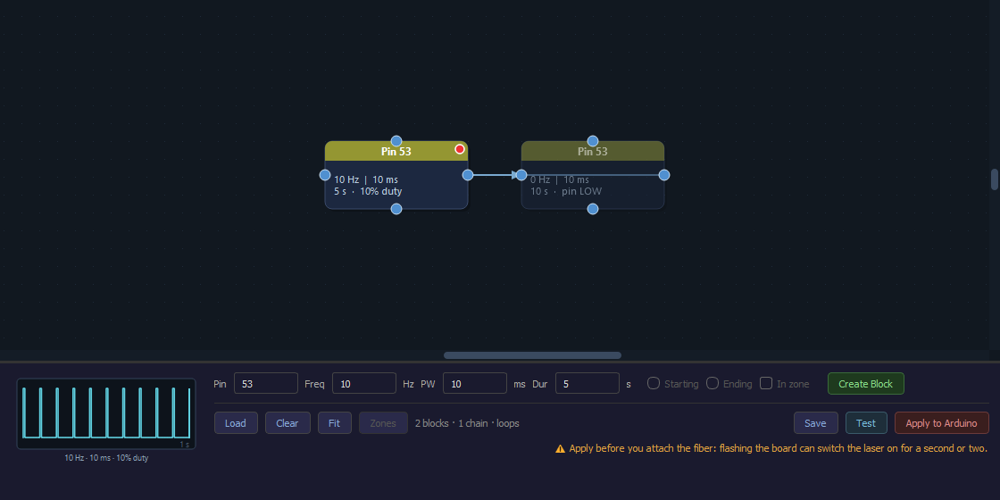

2. Make the baseline: set **Pin** to 53, **Freq** to 0, **PW** to 0 and **Dur** to 300, then click **Create Block**. A block at 0 Hz keeps the pin low, which is how you make a pause.
3. Make the stimulation block: **Freq** 20, **PW** 10 and **Dur** 30, then **Create Block**. You'll get 20 pulses a second, 10 ms each.
4. Make the post-period: **Freq** 0, **PW** 0 and **Dur** 300, then **Create Block**. With that block selected, tick **Ending**, so the recording stops when it finishes.
5. Join the blocks with arrows: drag from a port on the first block (one of the little circles on its edges) to a port on the second, then from the second to the third. The first block has no arrow coming in, so the chain starts there.
6. Check the status line under the canvas. It should read `Recording will stop 630 s after start.`
7. Before you attach the fiber, press **Apply to Arduino** and wait for `Upload successful — press Record to run paradigm.` It takes about 30 seconds. Applying flashes the board, and its pins float for a second or two while it resets, which is why the editor keeps a reminder about the fiber under **Apply**. Once it's done, a yellow lightning bolt appears beside **Record** in the main window, so you can tell at a glance that the next recording runs a paradigm.
8. Press **Test** to watch it run. A test drives the pin for real, so whatever's wired to it runs too. It plays the whole paradigm, so press **Stop Test** once you've seen it start.
9. Press **Save** if you'll use this paradigm again. Next time, **Load** it and press **Apply to Arduino**. Loading fits the view to the blocks it brings in, and if you ever lose one off the edge, **Fit** (or <kbd>Home</kbd>) shows them all again. The scroll bars reach the rest of the canvas.

Here are steps 2 to 7 in one go, cut short to two blocks on pin 53: 2 s off, then 4 s at 20 Hz. Until the arrow joins them, they're two chains on one pin, so the status line turns red for a moment. On our rig **Apply** takes about 30 seconds, but the simulated board here takes it at once:

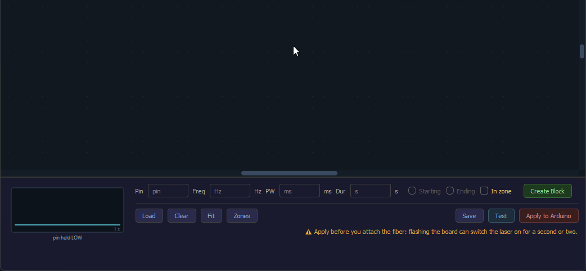

That's it! You can close the editor now, or leave it open while you record.

> [!TIP]
> Before you apply, glance at the caption under the waveform preview. A pulse as long as its period, or longer, holds the pin HIGH for the whole block ([The waveform preview](OVERVIEW.md#the-waveform-preview)).

> [!TIP]
> Want a loop? Draw an arrow from the last block back to the first, and tick **Starting** on the block the loop begins with. A loop keeps going until the recording stops, so either stop Record yourself or add a separate timer chain with an **Ending** block ([Ending](OVERVIEW.md#8-ending)).

> [!TIP]
> Done with stimulation for the day? **Clear** the canvas and press **Apply to Arduino**. The editor says `Upload successful — no paradigm: recordings run without stimulation.`, the bolt beside **Record** goes out, and the recordings after that run no paradigm.

### Pins

The trigger board's numbered sockets are its pins. A stimulation pin is either LOW, at 0 V, or HIGH, at the board's logic voltage (5 V on the Mega 2560), which a TTL input reads as off or on. The number you type in **Pin** is the number printed beside the socket. Panopticon has no idea what's wired to a pin, so a wrong number drives the wrong device.

Your rig's stimulation pins should be listed in its profile's `stim_safe_pins`, which you can read by opening the profile in Notepad. Ours is `[51, 53]`: pin 53 drives the laser, and pin 51 is the ultrasonic microphone's [gate](#devices-that-follow-the-recording), listed there so it stays low too. If that list is empty, or you're not sure, ask the rig's owner before you use a pin.

The editor won't let you use:

- the camera trigger pins, the profile's `trigger_pins` (ours are `[2, 4, 6, 8, 10, 12]`). Extra pulses on a trigger line would give one camera extra frames, and its block IDs would stop matching the other cameras';
- pins 0 and 1, which carry the board's serial link;
- the profile's [`gate_pins`](CONFIGURATION.md#gate_pins) (ours is `[51]`). A block there would cut the gate a [device that follows the recording](#devices-that-follow-the-recording) records on;
- anything above the profile's [`board_max_pin`](CONFIGURATION.md#board_max_pin), the board's highest pin.

### When the board resets

Every sketch Panopticon builds pulls the `stim_safe_pins` LOW, along with every pin a paradigm uses, as the very first thing it does. While the board is resetting, though, no sketch is running yet, and every pin floats. The board resets whenever Panopticon opens its serial port or flashes it:

- at launch, and when you choose a profile on a new computer or one whose board is on another port;
- at every **Apply to Arduino**, and at a **Test** that uploads a changed canvas first;
- when an acquisition needs the other sketch. Panopticon keeps two, recording-only and recording plus stimulation, and swaps them itself: after an Apply, a calibration flashes the recording-only sketch (`Flashing recording-only firmware…`) and the next recording flashes the paradigm back (`Flashing recording + stimulation firmware…`);
- at the first **Calibrate** or **Record** after a launch flash that failed;
- at the first **Calibrate** or **Record** after you switch between two profiles on the same port whose `trigger_pins`, `stim_safe_pins` or `gate_pins` differ. The switch itself flashes nothing;
- at the first **Calibrate**, **Record** or **Test** after the port couldn't be opened (the log said `will retry on first use`);
- at a start the board doesn't acknowledge at first. Panopticon then reopens the port once, and the log says `[teensy] no ack — reopening port to force a board reset`.

A [gate pin](#devices-that-follow-the-recording) floats during a reset too. A recorder that reads a floating input as high starts a file then, and each flash leaves one or two short files, one for the upload and one for the port reopening after it. A pull-down resistor from the gate line to ground, at the recorder's end, holds the line low through the reset. About 1 kΩ beats a typical TTL input's pull-up and takes about 5 mA from the pin when it's high. With the board unplugged, check that the line reads below 0.8 V.

If a flash fails, the acquisition doesn't start, since nobody knows what's on the board then. Panopticon also won't close during a flash, because an interrupted upload can leave the board without the guard that holds its stimulation pins low. For the same reason, don't end Panopticon from Task Manager while the state label reads `Clearing stim firmware…` or `Flashing …`, or while the editor reads `Compiling + uploading… (~30 s)`.

### After a stimulated recording

A recording with blocks on the canvas also writes these beside the videos:

- `stim_paradigm.json`: the paradigm as it stood when the recording started, with the sketch's hash and `matches_uploaded_firmware`, which always reads `true` for a recording made in this window. In a folder from an older version of Panopticon, `false` or `null` means the file may not describe what the board ran.
- `stim_paradigm.ino`: the sketch's source.
- `stim_trace.csv`: one row per trigger, with the stimulus the paradigm should have delivered at that trigger ([stim_trace.csv](#stim_tracecsv)).

`stim_trace.csv` is a model worked out from the block IDs, so it can't know what the device on the pin actually did. If you want evidence that the device fired, put a light that follows it, such as a sync LED, where a camera can see it.[^sync]

[^sync]: At our 100 fps and 3 ms exposure, a camera shows when a train starts and stops, but a 20 Hz train aliases against the frame rate. For pulse-level evidence, you'd need a photodiode on a spare board input.

### Closed-loop stimulation

A closed loop makes a block pulse only while a mouse is in a zone you draw, which is how you run real-time place preference. A zone is a set of shapes on one camera, named by a letter (A, B and on), and every block ticked **In zone** follows one zone: while the tracker finds a mouse in that zone, the block runs its pulses, and the rest of the time its pin stays low. Any mouse counts, so with cagemates in the arena, a cagemate in the zone turns it on too.

One laser needs one zone, however many shapes make it up: a mouse in any of its shapes turns it on. A second zone is for a second block that should follow a different area, such as a second laser for the other side of the arena. Two zones can share a camera.

Your profile needs a [`closed_loop`](CONFIGURATION.md#closed_loop) block, and the model needs a Python environment of its own ([Set up the tracker](#set-up-the-tracker)). Then, in the stimulation editor:

1. Fill in the block's **Pin**, **Freq**, **PW** and **Dur** as usual, tick **In zone** with no block selected, and press **Create Block**. The zone editor opens, with every camera's live view.
2. Click the camera you'll draw on. The one above the arena is the safe choice: in a side view, a zone on the floor doesn't line up with a point on the mouse's back. The camera opens large, and the new zone gets the next free letter.
3. Draw the zone with **Rectangle**, **Ellipse** or **Polygon**. Drag from corner to corner for a rectangle or an ellipse, and hold <kbd>Shift</kbd> for a square or a circle. For a polygon, click each corner and double-click (or press <kbd>Enter</kbd>) to close it. A right click takes back a corner. Any number of shapes can make up the zone.
4. Switch to **Select** to adjust: click a shape, drag it to move it, and drag a handle to resize it, or a polygon's corner to move that corner. <kbd>Ctrl</kbd>+<kbd>C</kbd> and <kbd>Ctrl</kbd>+<kbd>V</kbd> copy and paste shapes, and <kbd>Delete</kbd> removes them. Each zone has its own colour, and the mice the tracker finds are marked with lime circles. Watch them for a minute: every mouse should carry one, and nothing else should. If not, see [`min_confidence`](CONFIGURATION.md#closed_loopmin_confidence).
5. Press **Use zone A**. The block appears with `zone A` in its header. To make another block follow the same zone, create it the same way and pick zone A from the list. To give it a zone of its own, press **New zone**. On a camera's page, the new zone starts on that camera. On the cameras page, click the camera for it. With **Select**, a click on another zone's dimmed shape switches to that zone.
6. Apply as usual, and press **Save** to keep the paradigm and its zones in one file. Panopticon never brings a zone back by itself: **Load** the file next time, double-click a zone block to open its zone, and check it still lines up, since the arena can sit a little differently from one session to the next.

Once the paradigm is applied, the main window's preview outlines each zone it follows on its camera, in the zone's colour, and fills the zone while a mouse is in it. While a recording runs, the zones can be looked at but not changed, and the Expected stimulation panel says, for each zone block, whether a mouse is in its zone. A running zone block keeps its yellow outline throughout, and lights only while a mouse is in its zone.

With the defaults the tracker looks at 10 frames a second of every camera a zone is drawn on, and a zone turns on once a mouse has been in it for 2 tracked frames in a row and off after 3 without one ([`enter_updates`](CONFIGURATION.md#closed_loopenter_updates)). The pulses then start 0.1 to 0.2 s after a mouse enters, and stop 0.2 to 0.3 s after it leaves. A pulse already running when a zone turns off still finishes, and a mouse that comes straight back never makes the pulses come faster than the block's frequency.

> [!NOTE]
> The window sends each zone's state to the board 20 times a second. If those updates stop, because the tracker or Panopticon stopped, the board turns the zone off by itself 250 ms later. Stopping the recording turns every zone off too.

A closed-loop recording also writes these beside the videos:

- `closed_loop.csv`: one row per tracked frame of each camera, with its time, camera and block ID, the mice found and kept, the zones a mouse was in, each zone's state, whether it went to the board, the tracker's time, and every detection as `x:y:confidence`. Every detection is there, whatever its confidence, so a recording can be scored again at another threshold.
- `closed_loop.json`: the settings, the tracker, the zones as drawn, and `events`, each change of a zone with the block ID it applied from.

`stim_trace.csv` gains a `zone_<letter>_in` column per zone from those events, and a zone block's pulses appear there only while its zone reads 1. The window can't know the exact trigger at which the board heard each update, so the column can be a trigger or two off. As for any paradigm, a light that follows the stimulation pin, where a camera can see it, is the evidence of what was delivered.

#### Set up the tracker

The model runs in a Python environment of its own, so its GPU libraries stay out of Panopticon's. You'll do this once per computer. In PowerShell:

```powershell
uv venv C:\tracker-env --python 3.12
uv pip install --python C:\tracker-env\Scripts\python.exe "onnxruntime-gpu[cuda,cudnn]" numpy opencv-python-headless
```

Then point the profile at it, and at the model:

```yaml
closed_loop:
  model: models/cam5_centroid.onnx
  python: C:/tracker-env/Scripts/python.exe
```

The model is a SLEAP centroid model trained on the cameras' frames as they are, one gray channel, and exported to ONNX with `sleap-nn export`. Open **Zones** in the stimulation editor to check it: the status line names the tracker's error if the environment or the model is wrong. The `threshold` tracker needs no model and no environment ([`tracker`](CONFIGURATION.md#closed_looptracker)).

### If something looks different

**Record** checks that the board carries what the canvas shows, and won't start when they disagree:

| Dialog | What to do |
|---|---|
| `Apply the stimulation paradigm first` | The canvas holds a paradigm you haven't applied in this launch. Press **Apply to Arduino** |
| `Apply the edited paradigm first` | The canvas changed after the last Apply. Apply it again |
| `Apply the empty canvas first` | The canvas is empty, but the board still carries the paradigm you applied earlier. Apply the empty canvas |
| `Cannot record with this stim workflow` | An Apply failed or is still running, or the editor shows a problem in red, such as a forbidden pin |
| `Stop the stimulation test first` | A Test is running. Stop it in the editor |
| `No closed loop for the zone blocks` | A block is ticked **In zone**, and the profile has no [`closed_loop`](CONFIGURATION.md#closed_loop) block. Untick it and apply again, or add the block |
| `The tracker is not ready` | A block is ticked **In zone**, and the tracker is starting or has stopped. In the editor, **Zones** shows its state. If it shows an error, see [Set up the tracker](#set-up-the-tracker) |
| `Draw the zone first` | A block follows a zone with no shapes. Double-click the block to draw its zone |
| `A zone's camera is not open` | A zone is drawn on a camera this profile hasn't opened |

The last two stop **Calibrate** as well. If an upload fails, [Stimulation](TROUBLESHOOTING.md#stimulation) explains its messages.

[*Next up:* Record](#8-record)

---

## 8. Record

Everything's set up. Let's record!

1. Put the animals in the arena and close it.
2. If you're using a paradigm, look for the yellow bolt beside **Record**. It's there whenever the next recording will run the paradigm you applied:

    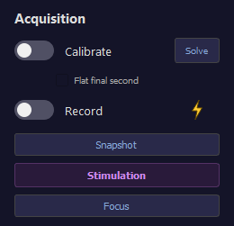

    No bolt means no stimulation. If you calibrated after applying the paradigm, Panopticon flashes it back onto the board first, and the pins float briefly while it does.
3. Flip **Record** on. The state label runs through `Checking capacity…` and `Starting...`, then reads **RECORDING**, with the time recorded so far counting up to its left. Each pane's frame rate climbs to the trigger rate (100 fps on our rig):

    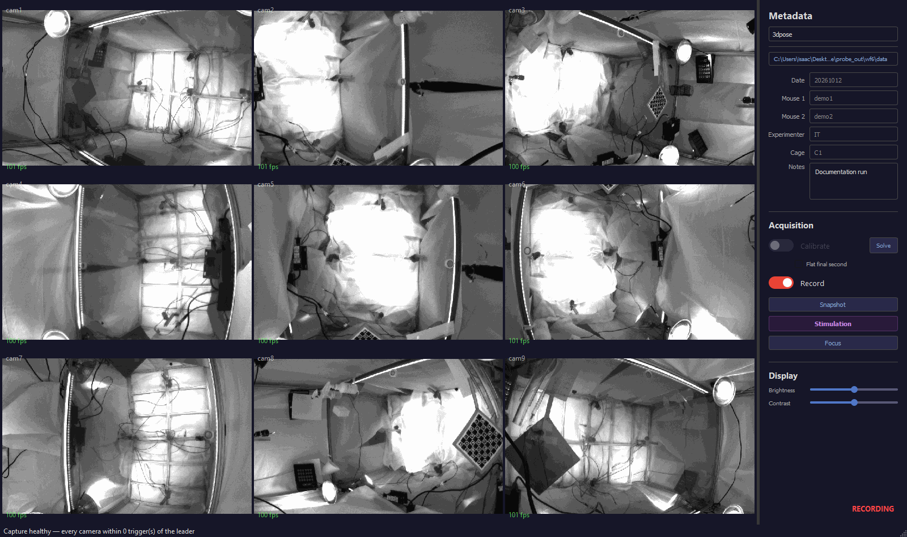

4. Keep an eye on the status bar while it records. `Capture healthy` means all's well, and [While it records](#while-it-records) covers everything else it can say.
5. When you're done, flip **Record** off. If your paradigm has an **Ending** block, it flips Record off for you.

Here's a short take, seen from the sidebar. The animals' IDs and a note go in, **Record** goes on, and the session fields grey out until it's off again:

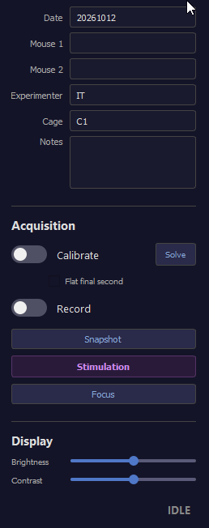

> [!TIP]
> Press **Snapshot** whenever you like to save a full-resolution still from every camera into the session's `snapshots/` folder.

### While it records

Panopticon keeps the videos in step as it records. With [kick-out](GLOSSARY.md#kick-out) on, which is the default (`realtime_kick: true`), a trigger that any camera missed is dropped from every video, so they all hold the same triggers. The status bar shows how far the slowest camera is behind the fastest, against a cap of `kick_max_lag` (480 triggers on our rig):

| Status bar | What it means |
|---|---|
| `Capture healthy — every camera within N trigger(s) of the leader` | All good. Every camera is within a quarter of the cap |
| `CAPTURE FALLING BEHIND: camN is N triggers behind the leader (cap C). Close other applications.` | A camera is lagging, but nothing is lost yet. Close other programs |
| `camN IS N TRIGGERS BEHIND THE LEADER (cap C): frames every camera captured are being dropped. Stop and investigate.` | Three quarters of the cap or more. At the cap, triggers are dropped from every camera. Stop, and look the message up in [During an acquisition](TROUBLESHOOTING.md#during-an-acquisition) |
| `... RETIRED: camN` | That camera was [retired](GLOSSARY.md#retirement), and the others stay aligned |
| `EVERY CAMERA IS RETIRED: nothing is being recorded. Stop the recording.` | Stop now |
| `NO FRAMES from camN for S s` | That camera has stopped delivering frames |
| `NO FRAMES FROM ANY CAMERA for S s: the trigger board may have stopped.` | Comes with a **No frames from any camera** dialog. Check the board and its USB cable. A board without power leaves its stimulation pins undriven |

With kick-out off, the status bar reports how late the slowest camera's frames arrive instead. It starts at `Capture healthy — keeping up with the trigger (max lag N ms)`, turns into `CAPTURE FALLING BEHIND: camN is S s behind real time and growing.` past 0.25 s, and into `CAPTURE S s BEHIND REAL TIME (camN).` past 1 s.

If a camera gets close to its shutdown temperature, the status bar starts with `CAMERA TEMPERATURE: camN T C ...`. The alert comes `thermal_warn_margin_c` below the shutdown temperature the camera reports, so our cameras, which shut down at 81 °C, warn at 79 °C. When you see it, stop at a point that suits the experiment and let the cameras cool before the next take, because a camera that reaches its shutdown temperature stops sending frames. Afterwards, `temp_max_c` under `camera_thermals` in `session_metadata.json` shows how hot each one got.

If the recording runs a paradigm, an **Expected stimulation** panel appears in the sidebar, under the **Display** sliders. Here it is about 10 seconds into the paradigm we built in [Optional: stimulation](#7-optional-stimulation):

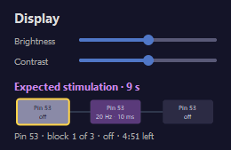

The panel is a small copy of your canvas, with pulsing blocks in purple and pauses in grey, each labelled with its pin and parameters as far as its size allows. The block each chain should be running right now is lit, with a yellow outline (here, the baseline). Under it there's a line for each chain, naming that block and counting down the time left in it, like `Pin 53 · block 1 of 3 · off · 4:50 left`. The title counts the time since the first trigger, and reads `Expected stimulation · waiting for the first trigger` until it arrives. When a chain has run its course, its blocks dim and its line reads `Pin 53 · finished`. Once every chain has finished, the title reads `Expected stimulation · over`.

Panopticon works all of this out from the trigger count, the same way it writes `stim_trace.csv`, so the panel lights the same block the trace will give that frame. Keep in mind that it shows what the paradigm *should* be doing, not a measurement. The board reports nothing back while it records, so only a light the cameras can see, like a sync LED, tells you the device on the pin really fired ([After a stimulated recording](#after-a-stimulated-recording)).

### Devices that follow the recording

Skip this unless your profile sets `gate_pins` or `collect_dirs`.

Another device can record along with the cameras, like the ultrasonic microphone on our rig. Panopticon can start and stop it with the triggers, and gather up what it writes:

- [`gate_pins`](CONFIGURATION.md#gate_pins) are board pins that go high with a recording's first trigger and low when its triggers stop. They stay low during a calibration and while the window is idle. Wire the pin to the device's TTL input, and set the device to record while the input is high. Our microphone's recorder, Avisoft-RECORDER, records on pin 51 with its trigger set to UltraSoundGate DIN and the `!` option on.
- [`collect_dirs`](CONFIGURATION.md#collect_dirs) names the folders the device writes into. When the recording finishes, every file in them that changed during the recording moves into a folder of the same name in the recording folder. Ours lands in `<mouse1>_<mouse2>_recording\usv\`. Older files stay where they are, and `session_metadata.json` lists what moved.

The gate rises with the first trigger and falls half a trigger period after the last one. A device that records the gate's level, as Avisoft-RECORDER does in the lowest bit of each sample when its trigger is DIN, can therefore line its recording up with the frames. Set a short pretrigger, 0.1 s on our rig, so the file holds the rising edge.

If the device still holds a file open when the recording finishes, Panopticon waits up to `collect_wait_s` seconds (30 by default) for it, then leaves it where it is and names it in `WARNINGS.txt`. A collected folder that gained nothing during the recording gets a line there too, since it usually means the device wasn't recording.

### Your own trigger source

Skip this unless your profile sets `trigger_source: external`.

In this mode, your own pulse generator or DAQ triggers the cameras, and Panopticon opens no serial port ([CONFIGURATION.md](CONFIGURATION.md#your-own-ttl-source) shows how to wire it). Stimulation needs Panopticon's board, so a recording with blocks on the canvas is refused. Every camera has to be armed before your first pulse, so a recording, or a calibration, goes like this:

1. Keep your source stopped, and flip **Record** (or **Calibrate**) on.
2. Panopticon arms every camera and watches them for 0.5 s, or five trigger periods if that's longer. If any camera gets a frame, your source was already running, and the start is refused with `The trigger was already running`.
3. When the state label reads `WAITING FOR TRIGGER` and a `Start your trigger source` prompt appears, start your source at the rate the prompt names: `frame_rate` for a recording, `calibration_frame_rate` for a calibration. The recording begins with the first pulse.
4. To finish, stop your source. The recording ends once no camera has had a frame for 2 s, or four trigger periods if that's longer.

If no pulse arrives within 45 s, the start ends in `NO TRIGGER` and nothing is kept. Pressing **Cancel** on the prompt does the same.

If you flip **Record** off while your source is still running, the state label reads `STOP YOUR TRIGGER SOURCE`. Panopticon counts the source as stopped after 1 s of silence, or two periods. If it's still running after 30 s, Panopticon stops the cameras itself and notes it in `WARNINGS.txt`.

### If something looks different

- **Overwrite the existing data?** The recording folder already holds a take. **Cancel**, the default, leaves it alone. **Yes** deletes everything in the folder except `calibration.toml`, and nothing brings it back, even if the start is refused after that. To keep the old take, change Date or a Mouse field first. With your own trigger source, the old take is set aside instead, and only deleted once the first trigger arrives.
- **Proceed?** The dialog asks `Start anyway?` and names what's worth a second look. It could be a disk that might not hold a 10-minute recording, an NVENC session cap it couldn't probe, encoding on the CPU with libx264, or raw capture faster than 1.5 GiB/s. Nothing has been recorded yet, so **No** is always safe.
- **A dialog refuses the start.** Nothing has been recorded. The dialog names the problem, such as not enough RAM, too few NVENC sessions, a camera that didn't arm within 30 s or a trigger board that didn't acknowledge the start. [Starting an acquisition](TROUBLESHOOTING.md#starting-an-acquisition) covers every one, and the **Proceed?** warnings too.
- **`Could not open the trigger board`.** Another program holds the board's port, such as the Arduino Serial Monitor. Close it and try again. Nothing has been deleted at this point.
- **One pane runs at about half the rate.** Its camera's exposure is probably over the ceiling ([CONFIGURATION.md](CONFIGURATION.md#trigger_rate_limit)).

[*Next up:* After you stop](#9-after-you-stop)

---

## 9. After you stop

Once **Record** is off, Panopticon finishes the files. Let's wait for it, then check the take while the animals are still here.

1. Wait for **IDLE**. The state label names each step as it goes, starting with `Finishing…`, and the **Record** toggle stays greyed out until the files are written:

    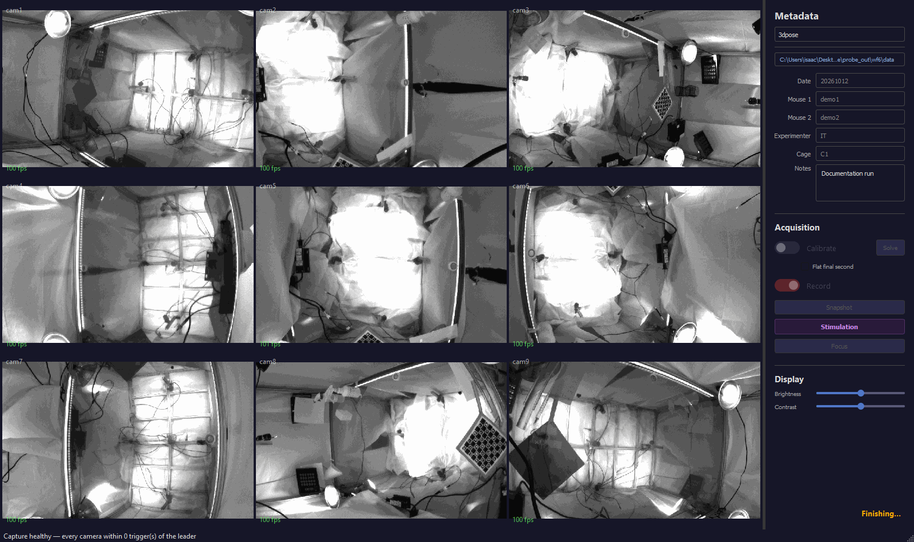

2. Read the status bar. `Recording encoded: F frames, R fps` with a single frame count means every camera kept the same frames:

    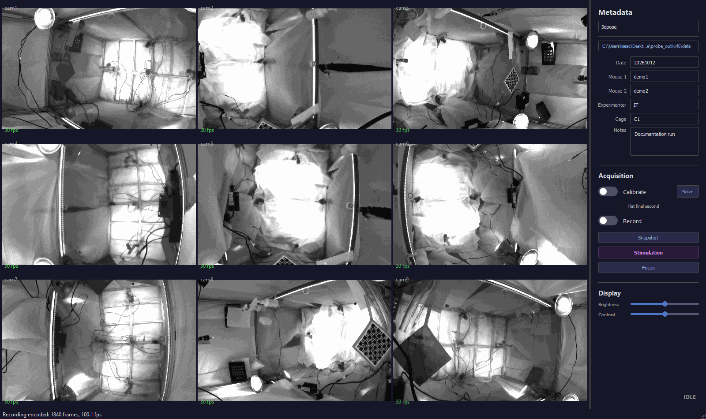

    A range such as `F1-F2 frames` means they didn't, and `k CAMERA(S) FAILED: camN` names cameras with no usable video.

3. Look for warnings. If there are any, the status bar ends with how many and where to find them, like `| 1 warning in <folder>\WARNINGS.txt`. [Warnings](#warnings) explains the usual ones.

4. Open one of the videos and check that the animal is neither black nor blown out, which the preview can't show you. If it needs more light, add infrared illumination first, then exposure, then gain ([CONFIGURATION.md](CONFIGURATION.md#pfs_path)).

5. After a stimulated recording, check the stimulation files ([After a stimulated recording](#after-a-stimulated-recording)).

You did it! A clean session ends with no dialog at all.

### What each step does

- `Finishing…`: the encoders catch up and the cameras go back to preview. Panopticon writes each camera's `blockids.npy` and `frametimes.npy`, the acquisition's `session_metadata.json` and `session.log`, and `stim_trace.csv` after a stimulated recording.
- **ENCODING**: each camera's capture becomes an mp4, and the sidebar shows `Encoding k/N`. With real-time encoding, the default, it's a quick copy of each `stream.h264`. With `realtime_encode: false`, each `raw.bin` is encoded, `encode_parallel` cameras at a time. A source file is deleted only once its mp4 checks out.
- **ALIGNING**: only without kick-out (`realtime_kick: false`), or with `realtime_encode: false`, and only when the cameras kept different frames. Each video is re-encoded to the triggers every camera recorded, and the status bar ends with `Aligned: N synchronized frames per camera`.

With kick-out, the videos already hold the same triggers, so nothing is re-encoded. If a camera was retired, or the videos differ anyway, `WARNINGS.txt` says so and gives the `2_align.py` command to run.

### Warnings

Problems found once the take is over go to `WARNINGS.txt` in the acquisition folder and to the log, never to a dialog. A new take deletes the old take's `WARNINGS.txt`, so the file always describes the take beside it. Here are the lines you're most likely to see:

| Line | What it means |
|---|---|
| `Effective frame rate X fps (target Y).` | More than 0.5% of the triggers were missed by some camera and dropped from every video. The videos stay aligned, and the counts are under `kickout` in `session_metadata.json` |
| `N triggers (...) are missing from every camera's video: they were force-dropped ...` | A camera fell more than `kick_max_lag` triggers behind |
| `camN was RETIRED mid-recording (...)` | That camera's video ends early, and the others stay aligned |
| `camN: block IDs advanced at R/s while ...` | Below the trigger rate, that camera ignored triggers: don't use the recording for 3D |
| `camN reached T C during this acquisition ...` | A camera ran hot |

[After a recording](TROUBLESHOOTING.md#after-a-recording) explains every line.

### Check the block IDs

Each frame's [block ID](GLOSSARY.md#block-id) is its trigger number, and each camera keeps its own in `blockids.npy`. When the frame counts differ, or a warning names a camera, let's check them:

1. In File Explorer, open the session folder. Hold **Shift**, right-click the `<mouse1>_<mouse2>_recording` folder and choose **Copy as path**.
2. Open PowerShell in the Panopticon folder: in File Explorer, click the address bar there, type `powershell` and press **Enter**.
3. Type the command below, press **Ctrl+V** to paste the path in place of `"<recording folder>"`, and press **Enter**:

    ```
    uv run python 2_align.py "<recording folder>"
    ```

It prints the cameras, the triggers every camera recorded, and a table like this:

```
cam     recorded  dropped   %drop    first     last
cam1        6022        0   0.00%        1     6022
cam2        6022        0   0.00%        1     6022
```

On a clean kick-out recording every `dropped` is 0. The same non-zero `dropped` on every camera is fine too: kick-out removed those triggers from all of them, and the videos are still aligned. A different count on one camera means the videos aren't aligned yet, so run the command again with `--replace` to re-encode them to the common triggers.

`--replace` refuses while a camera ended early, started late or stopped for more than about a second, since aligning to it would cut the others down. You can use `--exclude camN` to align the other cameras and leave that one as recorded, or `--truncate-to-shortest` to cut every camera anyway. The command also runs the [block-ID rate check](GLOSSARY.md#block-id-rate-check) on every camera, which catches a camera that ignored triggers but kept a clean-looking frame count.

### Quitting in the middle

If you close the window while something is running, Panopticon asks first, with **No** as the default:

| State | What **Yes** does |
|---|---|
| **RECORDING** or **CALIBRATING** | Deletes the unfinished capture |
| **ENCODING** | Keeps the capture. Run `0_encode.py`, then `2_align.py` on the folder, with `--replace` for a recording made without kick-out |
| **ALIGNING** | Keeps the videos, partly aligned. Run `2_align.py --replace`, then `3_stim_trace.py` |
| A solve, a profile switch or a camera operation | Cancels it, and deletes nothing |

The dialog gives the commands for your folder. Panopticon won't close during a firmware flash. Quitting always sends the board a stop, and if the board doesn't confirm it, you'll see **Trigger board did not confirm the stop** before the window closes.

### The next animals

Changing Mouse 1 or Mouse 2 starts a new session folder, with no calibration in it. For the next animals, either:

- calibrate and solve again, then record; or
- if no camera has moved, copy `calibration.toml` from the first session's `calibration/` folder into the new `<mouse1>_<mouse2>_recording/` folder (create it if it isn't there yet), then record. A folder that holds only `calibration.toml` raises no overwrite question, and the file stays.

When you're all done, wait for **IDLE** and close the window. Then copy the session folders to wherever your lab keeps its data.

### If something looks different

- **Trigger board did not confirm the stop.** The board may still be triggering, and a looping paradigm may still drive its pin. Power-cycle the board: unplug its USB cable, and its power supply if it has one, wait 5 s, and plug it back in.
- **Recording did not finish cleanly.** Saving failed, for example on a full disk. The capture files stay in the folder, neither encoded nor deleted, so don't record into that folder again. Once the cause is fixed, `uv run python 0_encode.py "<folder>"` turns them into mp4s. The cameras are closed, so switch profile and back, or restart Panopticon, to reopen them.
- **A dialog says no video was replaced.** A camera ended early or stopped for a while, so the alignment wrote its index and left the videos alone. [Check the block IDs](#check-the-block-ids) gives the options.
- **`stream.h264` or `raw.bin` files are still there.** The encode didn't finish. Run `0_encode.py` on the folder, as above.

[*Next up:* What the session leaves on disk](#10-what-the-session-leaves-on-disk)

---

## 10. What the session leaves on disk

Here's where everything lands and what each file is, for when you need to look something up.

### Paths and names

```
<output>/<date>/<mouse1>_<mouse2>/calibration/<camN>/
<output>/<date>/<mouse1>_<mouse2>/<mouse1>_<mouse2>_recording/<camN>/
```

The date and the mouse IDs come from the sidebar, and blank mice become `m1` and `m2`. `calibration/` and the recording folder sit side by side, so one calibration serves the recording beside it. The recording folder carries the mouse IDs so that recordings uploaded together, to LUC3D for example, keep distinct names. Videos are named `<date>-<mouse1>_<mouse2>-<camN>-<calibration|recording>.mp4`, for example `20260928-demo1_demo2-cam1-recording.mp4`, and the solve finds its videos by the `calibration` in their names.

### Every file a session can contain

In each camera folder:

| File | What it is |
|---|---|
| `<date>-<session>-<camN>-<type>.mp4` | The video: H.264, one keyframe per second, with its index at the front so a browser can seek |
| `blockids.npy` | One trigger number (block ID) per frame. A dropped frame leaves a gap |
| `frametimes.npy` | 2 × F: frame numbers 1 to F, and each frame's device time in seconds from the first |
| `WARNINGS.txt` | Written when this camera's block IDs had to be repaired to match its video, or its encode lost frames |
| `RETIRED.json` | Written when the camera was retired: why, and its last block ID |
| `encode_error.log`, `tail_error.log` | Written when an encode failed: ffmpeg's output |
| `stream.h264`, `raw.bin` | Capture files, deleted once the mp4 checks out. Left behind, they mean the encode didn't finish |
| `raw_tail.bin`, `encoded.json` | Frames written raw after a camera's encoder failed, and where they start. The encode merges them |
| `blockids.full.npy`, `frametimes.full.npy` | The full arrays, kept when a failed merge cut the metadata to the mp4 |
| `frametimes_synthesized.json`, `frametimes.orig.npy` | An alignment made the frame times from block IDs. The rate check then skips this camera |
| `aligned_tmp.mp4` | An alignment in progress |

In the acquisition folder, `calibration/` or `<mouse1>_<mouse2>_recording/`:

| File | What it is |
|---|---|
| `session_metadata.json` | This acquisition's metadata ([below](#session_metadatajson)) |
| `session.log` | The log from arming the cameras to the end of the encode |
| `WARNINGS.txt` | Written when something went wrong |
| `calibration.toml` | The solve's result: each camera's image size, camera matrix, distortion, rotation and translation in aniposelib's layout, with the quality figures in a `[metadata]` block. Match cameras by each section's `name`. Solve copies it into the recording folder |
| `skeleton.json` | The profile's [skeleton](CONFIGURATION.md#skeleton), which LUC3D loads with the session. Recording only, when the profile names one |
| `calibration_report.json`, `reprojection_error_histogram.png` | The solve's figures, for the window, and its pairwise plot. Calibration only |
| `codet_frames.json` | The triggers at which two or more cameras saw the board, which lets the solve decode only those frames. Calibration only |
| `stim_paradigm.json`, `stim_paradigm.ino`, `stim_trace.csv` | The paradigm, its sketch and the modelled stimulus per trigger ([After a stimulated recording](#after-a-stimulated-recording)) |
| `closed_loop.csv`, `closed_loop.json` | The tracked cameras' mice per tracked frame, the zones and their changes ([Closed-loop stimulation](#closed-loop-stimulation)). Recording only, with a block ticked **In zone** |
| `<folder>/`, such as `usv/` | What a [collected folder](CONFIGURATION.md#collect_dirs) gained during the recording, under that folder's name ([Devices that follow the recording](#devices-that-follow-the-recording)). Recording only |
| `aligned/alignment.npz`, `aligned/alignment.json` | The alignment index, written whenever an alignment runs ([below](#aligned)) |

The session folder itself holds a copy of `session_metadata.json` from the session's first acquisition, which is never overwritten, and `snapshots/<date>_<HHMMSS>/camN.png`. The launch log stays in `logs\` in the Panopticon folder.

### session_metadata.json

Each acquisition writes its own copy when it stops. It holds:

- the sidebar fields and the profile's name;
- the cameras' names, serials and models, in cam1 to camN order;
- the frame rates, the resolution and the time;
- the host, the OS, Python, the GPU with its driver and memory, and the NVENC sessions available;
- each camera's temperatures (`camera_thermals`, where `temp_max_c` is the one to read);
- the encoder used and the one the profile asked for;
- settings the videos can't show, among them `trigger_source`, `gate_pins`, `log_level`, `nvenc_upload`, `thermal_warn_margin_c` and `capture_processes`;
- `kickout`: the triggers decided, kept, kicked out and force-dropped, and the [effective frame rate](GLOSSARY.md#effective-frame-rate);
- `collected`: for each collected folder, the files that moved into the recording and the files left behind;
- `log`: the log's level and file, and any lines this acquisition lost;
- `camera_stream_stats` and `nvenc_upload_used`.

### stim_trace.csv

One row per trigger, with these columns:

- `frame`: the frame's index in the reference camera's video, counted from 0;
- `blockid`, `t_s` and `any_active`;
- per chain, `chain<i>_step`, `chain<i>_active`, `chain<i>_freq_hz` and `chain<i>_pw_ms`;
- a modelled `pin<N>_ttl` per pin;
- `zone_<letter>_in` per zone a block follows: whether that zone was on for the trigger;
- a `frame_<cam>` column per camera, blank where that camera has no frame for the trigger.

When the videos are aligned, every `frame_<cam>` equals `frame`. `2_align.py --replace` rewrites the file, and `3_stim_trace.py` writes it again by hand.

### aligned/

`alignment.npz` holds `common_block_ids`, `frame_index` (cameras × common triggers), `camera_names` and `video_is_common`. `alignment.json` holds a readable summary: `trigger_span`, `common_frames`, whether alignment was `needed` and whether the videos were `replaced`; per camera, `recorded`, `dropped`, `video_is_common` and `frametimes_synthesized`; and any `excluded` or `short_cams`, a `refused` replace, `failures` and rate warnings.

An `aligned/` folder beside a clean recording usually means someone ran `2_align.py` to check it. Its `alignment.json` then reads `replaced: false`, with every `dropped` at 0.

### An example session

Here's a session on our rig, recorded with Mouse 1 `demo1` and Mouse 2 `demo2`, after one calibration, one solve, one recording and one snapshot:

```
demo1_demo2/
├── calibration/
│   ├── cam1/
│   │   ├── 20260928-demo1_demo2-cam1-calibration.mp4
│   │   ├── blockids.npy
│   │   └── frametimes.npy
│   ├── cam2/ … cam9/
│   ├── calibration.toml
│   ├── calibration_report.json
│   ├── codet_frames.json
│   ├── reprojection_error_histogram.png
│   ├── session.log
│   └── session_metadata.json
├── demo1_demo2_recording/
│   ├── cam1/
│   │   ├── 20260928-demo1_demo2-cam1-recording.mp4
│   │   ├── blockids.npy
│   │   └── frametimes.npy
│   ├── cam2/ … cam9/
│   ├── calibration.toml
│   ├── session.log
│   ├── session_metadata.json
│   └── skeleton.json
├── snapshots/
│   └── 20260928_095215/
│       └── cam1.png … cam9.png
└── session_metadata.json
```

`cam2/ … cam9/` stands for the other camera folders, which hold the same files as `cam1/`. The recording ran with an empty canvas, so it has no stimulation files, and a clean take has no `WARNINGS.txt` and no `stream.h264` or `raw.bin` left behind. A stimulated recording also holds `stim_paradigm.json`, `stim_paradigm.ino` and `stim_trace.csv` beside its `session.log`.

### The command-line tools

Each one runs from the Panopticon folder and takes `--help`:

| Command | What it does | Exit status |
|---|---|---|
| `uv run python 0_encode.py <folder>` | Turns an acquisition's capture files into mp4s when the window's encode didn't finish | 0 done; 1 a camera failed; 2 a camera holds fewer frames than captured |
| `uv run python 1_calibrate.py <session> --board-config <file>` | The solve ([Solving by hand](#solving-by-hand)) | 0 solved, also when cameras were left out; 1 failed |
| `uv run python 2_align.py <folder> [--replace]` | Checks the block IDs and their rate, and aligns the videos with `--replace` | 0 fine; 2 a warning; 1 an error or a refused replace |
| `uv run python 3_stim_trace.py <folder>` | Writes `stim_trace.csv` again | 0 fine; 2 the cameras disagree; 1 skipped |

For FLIR cameras, `probe_flir.py` tests each camera before a first recording ([FLIR.md](FLIR.md)).

[*Next up:* Configuration](CONFIGURATION.md), which describes every setting of a profile.
